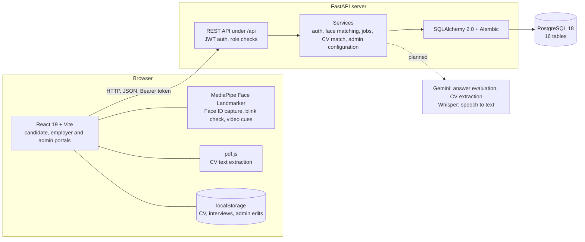

# Intervo Backend

REST API and PostgreSQL database for **Intervo**, an AI-assisted interview coaching and candidate screening platform.

Final Year Project, Department of Software Engineering, University of Gujrat.

Intervo helps a candidate prepare for interviews: it reads their CV, shows the skill gap against a target role or job description, runs mock interviews in text, voice or video, and tracks weak skills over time. Employers post jobs and see applicants ranked by how well their CV skills match the job, only for candidates who agreed to share. Employers never see interview scores. An admin configures the roles, skills, questions and scoring rules.

This repository is the server side. The React app is in **[Intervo-Frontend](https://github.com/shuneenraza-bot/Intervo-Frontend)**.

**Stack:** Python 3.13 · FastAPI · SQLAlchemy 2.0 · PostgreSQL 18 (psycopg 3) · Alembic · Pydantic · PyJWT · pwdlib (argon2) · pytest

## Contents

- [Features and objectives](#features-and-objectives)
- [Architecture](#architecture)
- [Setup on Windows](#setup-on-windows)
- [Demo accounts](#demo-accounts)
- [30% milestone](#30-milestone)
- [Known limitations](#known-limitations)
- [Endpoints](#endpoints)
- [Database](#database)
- [Project layout](#project-layout)

## Features and objectives

Status at the 30% evaluation. "Where it runs" matters because part of the system still runs in the browser (see [Known limitations](#known-limitations)).

| # | Objective | Feature | Where it runs | Status |
|---|---|---|---|---|
| 1 | Secure, role-based access | Sign up and sign in for candidates and employers, seeded admin, JWT, argon2 password hashes, attempt limits | Backend | ✅ Done |
| 2 | Two-factor sign-in | Password first, then face verification with a blink liveness check. Both are required for every role, at sign-up and sign-in | Capture in browser (MediaPipe), matching on backend | ✅ Done (prototype matcher) |
| 3 | CV analysis and skill gap | Parse PDF/DOCX/TXT, extract skills, compare with a role template or a pasted job description | Browser (pdf.js) | ✅ Done in browser · ⏳ server-side with Gemini |
| 4 | Mock interviews | Text, voice and video modes; questions chosen from weaknesses, CV gaps and the role's key skills; follow-up questions | Browser, and backend (`/api/interviews`) | ✅ Done in browser and on the server |
| 5 | Answer evaluation and feedback | Per-criterion scores against the admin rubric | Browser (rules); backend (Gemini with rule-based fallback) | ✅ Done |
| 6 | Speech to text | Spoken answers become a transcript | Browser (Web Speech API) | ✅ Browser · ⏳ Whisper |
| 7 | Presentation cues in video mode | Eye contact and expressiveness from face landmarks | Browser (MediaPipe) | ✅ Done |
| 8 | Progress tracking | Score history per skill and persistent weakness detection | Browser; session scores are also saved to PostgreSQL | ✅ Done |
| 9 | Employer module | Job postings with weighted skills, applications with consent, applicants ranked by CV skill match only (never interview scores) | Backend | ✅ Done |
| 10 | Admin configuration | Domains, roles, skills, question templates, criteria and rules | Admin-only CRUD under `/api/admin/*`; every change applies on the next request, nothing is cached | Backend | ✅ Done |
| 11 | Persistent storage | 14-table PostgreSQL schema with migrations | Backend | ✅ Done |
| 12 | Deployment | Hosted demo | Not started | ⏳ Planned |

## Architecture



Solid lines exist today. The dotted line is planned work.

What goes to the server today: accounts and sign-in, Face ID templates, job postings, applications, the configuration the employer pages read, and a copy of each candidate's skills, CV summary and interview scores (needed for the ranking). CV text, contact details and answer text stay in the browser.

The database design is in **[docs/ERD.md](docs/ERD.md)**.

## Setup on Windows

You need:

- [Python 3.13](https://www.python.org/downloads/)
- [PostgreSQL 18](https://www.postgresql.org/download/windows/) (the installer includes pgAdmin). Remember the password you set for the `postgres` user.
- [Node.js](https://nodejs.org/) 20 or newer, for the frontend
- Git

### 1. Create the database

In pgAdmin: right-click **Databases** → **Create** → **Database…** → name it `intervo` → **Save**.

### 2. Backend

Run these in PowerShell from this folder.

```powershell
# Virtual environment and packages
py -3.13 -m venv .venv
.\.venv\Scripts\Activate.ps1
python -m pip install --upgrade pip
pip install -r requirements.txt

# .env from the example, with a random JWT secret
Copy-Item .env.example .env
$secret = python -c "import secrets; print(secrets.token_urlsafe(48))"
(Get-Content .env) -replace 'change-me-to-a-long-random-string', $secret | Set-Content .env -Encoding utf8
notepad .env    # replace YOUR_PASSWORD in DATABASE_URL, save, close

# Create the tables, then load the configuration and demo data
alembic upgrade head
python -m scripts.seed

# Run the server
uvicorn app.main:app --reload --port 8000
```

- If PowerShell refuses to run `Activate.ps1`, run `Set-ExecutionPolicy -Scope CurrentUser RemoteSigned` once.
- If your Postgres password contains `@ : / # % ?`, URL-encode those characters in `DATABASE_URL` (for example `@` becomes `%40`).
- `.env` is ignored by Git. Never commit it.

Check it: http://localhost:8000/api/health should return `{"status":"ok","database":"ok"}`. Interactive API docs (Swagger) are at http://localhost:8000/docs.

### 3. Frontend

In a second PowerShell window, in the [Intervo-Frontend](https://github.com/shuneenraza-bot/Intervo-Frontend) folder:

```powershell
npm install
Copy-Item .env.example .env
npm run dev          # http://localhost:5173
```

The frontend's `.env.example` already points at this server:

```
VITE_BACKEND_MODULES=auth,employer
VITE_API_URL=http://localhost:8000/api
```

### 4. Tests

```powershell
pytest -v
```

The 46 tests run against a separate database, `intervo_test`, which is created automatically. They never touch `intervo`.

### Maintenance scripts

| Command | What it does |
|---|---|
| `python -m scripts.seed` | Loads configuration and demo data. Safe to run again; existing rows are left alone. |
| `python -m scripts.cleanup_test_data --dry-run` | Lists users with an invalid email and job titles with stray quotes, without changing anything. |
| `python -m scripts.cleanup_test_data` | Fixes the job titles, then asks before deleting the listed users and their data. |
| `python -m scripts.generate_erd` | Regenerates `docs/ERD.md` from the models. |

## Demo accounts

Created by the seed script.

| Role | Email | Password |
|---|---|---|
| Candidate | ayesha@intervo.demo | Demo@1234 |
| Employer | hr@northstar.demo | Demo@1234 |
| Admin | admin@intervo.demo | Admin@1234 |

Two more demo candidates, `bilal@intervo.demo` and `sana@intervo.demo` (password `Demo@1234`), have applied to the employer's jobs so the ranking has data.

## 30% milestone

### Done

- **Authentication on the real backend.** Sign up, two-factor sign in (password, then face verification, both required), JWT sessions, argon2 hashes, lockout after repeated failures.
- **Employer module on the real backend.** Create, edit, close and reopen job postings with weighted skills and a minimum CV match. Candidates apply with consent. Employers see applicants ranked by CV skill match (matched, partial and missing skills, experience and education checks, a short CV summary) and can shortlist or decline. No interview data reaches employers.
- **Admin configuration on the real backend.** Admins manage domains, roles, skills, question templates, evaluation criteria, scoring rules and see users and counts, all validated and saved to PostgreSQL (`/api/admin/*`). The interview engine, CV matching, evaluation and the employer list read configuration from the database on every request, so changes apply immediately.
- **Candidate sync.** A candidate's skills and CV summary are saved to PostgreSQL so the ranking uses real data (their session scores are kept for the candidate's own progress, not for employers).
- **CV analyzer** (frontend): PDF, DOCX or pasted text, skill extraction, weighted skill-gap against a role or job description.
- **Mock interviews** (frontend): text, voice and video, with follow-up questions and presentation cues.
- **Dashboards** (frontend): candidate overview and progress, employer hiring overview, admin configuration.
- **Database.** 16 tables with constraints and Alembic migrations, a seed script and an [ERD](docs/ERD.md).
- **Tests.** 169 automated API tests: two-factor sign up and sign in, face verification, lockouts, admin face reset, jobs, applications, the shortlist flow (notifications, accept/decline, contact sharing), CV-only ranking and privacy rules, the interview engine and the admin endpoints.

### Next steps

1. Move answer evaluation to the server with Gemini, with JSON validation of the model's output and the rule-based scorer as a fallback.
2. Move CV parsing to the server (`POST /api/cv/analyze`, `POST /api/jd/parse`) with Gemini-assisted extraction.
3. Send recorded audio to Whisper for transcription instead of relying on the browser.
4. Serve interviews from the server (`POST /api/interview/evaluate`, `GET /api/sessions`) so history follows the candidate across devices.
5. Add endpoints to delete an account and its history.
6. Replace the Face ID matcher with a face-embedding model and add password reset.
7. Deploy, then run user testing with students.

## Known limitations

These are stated plainly so the evaluation reflects what is really built.

- **Answer scoring is rule-based.** Answers are scored in the browser from keywords, length and structure. It is consistent and explainable, but it does not understand meaning. Gemini will replace it. Scores are a practice aid, not ground truth.
- **Face matching is a prototype.** The browser measures ratios between face landmarks and the server compares them with a mean-difference formula against a threshold. The blink check stops a printed photo, but this is not a trained face-recognition model and has not been measured for false accepts. It is the second factor next to the password, not a replacement for it. An admin can reset a user's face if the camera stops working for them.
- **CV parsing and interviews still run in the browser.** The server has no `/cv`, `/jd` or `/interview` endpoints yet. Answer text and the full CV stay in the browser's `localStorage`, so that history does not move to another browser or device. Only skills, a CV summary and per-answer scores (with the video cues) reach the database.
- **No account deletion endpoint yet.** "Delete history" and "Delete account" in the app clear the browser copy only. The rows in PostgreSQL stay until a delete endpoint is added. The sharing switch is enforced on the server.
- **Admin screens need the `admin` module.** Without `admin` in the frontend's `VITE_BACKEND_MODULES` the admin console edits only the browser's copy. Employer experience and education checks are read from the job description text (for example "2+ years"), not from separate job fields.
- **Speech to text depends on the browser.** Voice and video modes use the Web Speech API, which works in Chrome and Edge.
- **Rate limiting is per account, in the database.** There is no IP-based limiting, email verification or password reset yet.
- **Not deployed.** The system runs on localhost.

## Endpoints

All routes are under `/api`. Full request and response shapes are in the frontend's [API.md](https://github.com/shuneenraza-bot/Intervo-Frontend/blob/main/API.md) and at `/docs`.

| Method | Path | Who | Purpose |
|---|---|---|---|
| GET | `/api/health` | public | Server and database check |
| POST | `/api/auth/signup` | public | Create a candidate or employer account. Returns `{ pendingToken, faceEnrolled: false, expiresIn }`; the face must be enrolled before there is a full token |
| POST | `/api/auth/login` | public | Step 1. Body: `{ email, role, password }`. Returns `{ pendingToken, faceEnrolled, expiresIn }` (a 5-minute `face_pending` token), never a full token |
| POST | `/api/auth/face/verify` | face-pending token | Step 2 for an enrolled account. Body: `{ template, liveness: { blink: true } }`. Returns `{ token, user }` (the full token) |
| POST | `/api/auth/face/enroll` | face-pending token | Step 2 for an account without a face. Body: `{ template }`. Returns `{ token, user }`; `409` if a face is already enrolled |
| GET | `/api/auth/me` | signed in (full token) | The current user |
| PUT | `/api/auth/face` | signed in (full token) | Re-enrol: replace the face template. There is no delete. Body: `{ "template": { "v": 2, "method": "landmarks", "features": [...] } }` |
| GET | `/api/config` | signed in | Domains, skills, roles, questions, criteria and rules |
| GET, POST | `/api/admin/domains`, `/roles`, `/skills`, `/questions` | admin | List and create. Skills have `aliases`, `related`, `tip`; roles have weighted skills (1 to 3); questions have `skill`, `type`, `text`, `keywords`, `followUp` |
| PUT, DELETE | `/api/admin/domains/{id}`, `/roles/{id}`, `/skills/{id}`, `/questions/{id}` | admin | Edit or delete. `404` unknown id, `409` duplicate name or still in use (for example `Skill is used by a role`) |
| GET, PUT | `/api/admin/criteria` | admin | Weight 1 to 3 and `enabled` per criterion |
| GET, PUT | `/api/admin/rules` | admin | `weakThreshold`, `weakMinSessions`, `followUpBelow`, `defaultQuestions`, `faceThreshold`, each range-checked |
| GET | `/api/admin/users`, `/api/admin/stats` | admin | Accounts (no password hashes or face templates) and the counts for the overview |
| POST | `/api/admin/users/{id}/reset-face` | admin | Clears the user's face template. Their open sessions stop working and they enrol a new face at the next sign-in |
| GET | `/api/jobs` | signed in | `{ jobs, applications }`. Open jobs; employers also get their own closed jobs, `applicantCount` and the applications on their jobs |
| POST | `/api/jobs` | employer | Create a job with weighted skills and success criteria |
| PUT | `/api/jobs/{id}` | job owner | Replace a job |
| PATCH | `/api/jobs/{id}/status` | job owner | `{ "status": "open" \| "closed" }` |
| POST | `/api/jobs/{id}/apply` | candidate | `{ "consent": true }`. Consent also turns on profile sharing |
| DELETE | `/api/jobs/{id}/apply` | candidate | Withdraw the application |
| PATCH | `/api/applications/{id}/status` | job owner | `{ "status": "shortlisted" \| "not_progressing", "message"?: string (max 500) }`. Notifies the candidate. `409` once the candidate has answered, `403` for another employer |
| GET | `/api/applications/mine` | candidate | Own applications: job, company, `status`, `employerMessage`, `candidateNote`, `appliedAt`, `updatedAt`, `history`. `employer` (name, company, email) only after they accepted |
| POST | `/api/applications/{id}/respond` | candidate | `{ "decision": "accept" \| "decline", "note"?: string (max 500) }`. Only while `shortlisted`, only once (`409` otherwise), only on their own application (`403`). Notifies the employer |
| GET | `/api/notifications` | signed in | Own notifications, newest first (`?limit=` up to 100): `{ id, type, title, body, link, createdAt, readAt, read }` |
| GET | `/api/notifications/unread-count` | signed in | `{ "count": n }` |
| POST | `/api/notifications/{id}/read` | signed in | Mark one read (`404` for someone else's) |
| POST | `/api/notifications/read-all` | signed in | Mark all of your own read |
| GET | `/api/jobs/{id}/candidates` | job owner | Applicants ranked by CV skill match. No interview data. `candidate` is `{ id, name }`; a `contact` object (name, email, phone from the CV if any) is added only when the application is `accepted` |
| PUT | `/api/profile` | candidate | Save `{ skills, cv: { education, experienceYears, projects } \| null, shareWithEmployers }` |
| POST | `/api/sessions` | candidate | Save a finished practice session's scores. Re-sending the same `id` returns the stored session with `200` |
| POST | `/api/interviews` | candidate | Start an interview: `{ roleId \| jobId, mode, count }`. Questions are chosen on the server (weaknesses, CV gaps, role skills, one behavioural) with a `reason` each |
| POST | `/api/interviews/{id}/answers` | candidate | `{ questionId, answer, indicators? }`: rubric score, tips, provider and a follow-up question when needed |
| POST | `/api/interviews/{id}/answers/{answerId}/follow-up` | candidate | `{ answer }`: re-scores the original answer and the follow-up together |
| POST | `/api/interviews/{id}/finish` | candidate | Computes the session score, marks it `completed` and returns the summary |
| GET | `/api/interviews`, `/api/interviews/{id}` | candidate | Own history and one interview (other candidates' ids return `404`) |
| GET | `/api/progress` | candidate | Per-skill history, score trend and weakness profile with coaching tips |
| POST | `/api/cv` | candidate | Upload a CV (multipart `file`: PDF/DOCX/TXT, max 5 MB). Returns `{ cv, provider, fileName, text }` and saves it. Alias: `/api/cv/analyze` |
| GET | `/api/cv` | candidate | The saved parsed CV |
| PUT | `/api/cv` | candidate | Save the user's edits to the parsed CV |
| POST | `/api/cv/match` | candidate | `{ roleId }` or `{ jd }`: matched / partial / missing skills, weighted percentage and requirement checks (deterministic) |
| POST | `/api/jd/parse` | candidate | `{ text, roleSkills? }` -> skills with weights (3 must, 2 normal, 1 nice to have), `minYears`, `education`, `fresherFriendly` |

### CV analysis and the AI provider layer

`AI_PROVIDER=gemini|rules` in `.env` picks the provider (`app/services/ai/`). Gemini output is validated with Pydantic; invalid JSON is retried once, and any failure (no key, quota, timeout, bad output) falls back to the rule-based parser, which ports the frontend's `cvParser.js`. Every CV and job-description response says which one answered in `provider`. Only the CV text is sent to Gemini, with email, phone and profile-link lines removed first; contact details are read locally. Skills returned by Gemini are matched to the `skills` table by name and alias in the application, and the rest become `otherSkills`. The extracted text is stored, never the uploaded file. Matching (`/api/cv/match`) never uses AI. After pulling this change run `alembic upgrade head`; `docs/sample-cv.txt` is a CV to try.

### Interview engine

Walkthrough: [docs/run-an-interview.md](docs/run-an-interview.md). Selection and skill history port `selectQuestions` and `skillPerformance` from the frontend. Answers are scored against a fixed rubric: Gemini returns 0 to 100 per criterion plus tips, the application validates and clamps them and calculates the overall score from the `evaluation_criteria` weights (the model never does). Invalid or unavailable Gemini output falls back to the rule-based evaluator (a port of `evaluateAnswer`). Only the role title, skill, question, rubric and answer text are sent to Gemini, never the candidate's name or email. Run `alembic upgrade head` after pulling this change.

### Candidate ranking and privacy

`GET /api/jobs/{id}/candidates` returns `{ job, hidden, candidates }`. Employers get **only the CV skill match** (see `app/services/matching.py`), ranked by it, best first. Each candidate has:

- `match`: the job's weighted skills against the candidate's CV skills as `matched`, `partial` (a related skill earns half the weight) and `missing` lists, the `percentage`, `checks` for experience and education, and `meetsCriteria`, which is true when the percentage reaches the job's minimum CV match (`success.minMatch`). The checks are read from the job description ("2+ years", "Bachelor's degree") and compared with the CV.
- `cvSummary`: top degree, years of experience and number of projects.
- `candidate` (id, name) and `application`. A `contact` object is added only after the candidate accepts a shortlist (see below).

Interview scores are never part of the response: no sessions, evidence, practice consistency, weak skills, session counts or answer text. Jobs have no minimum interview score.

- Only applicants with `consent = true` on the application **and** `share_with_employers = true` on their profile are returned. Everyone else is only counted in `hidden`.
- Interview data, answer text, video indicators, face templates and CV contact details are never sent to employers, except the name, email and phone of a candidate who accepted a shortlist.

### Shortlist flow, contact sharing and notifications

`applied → shortlisted → accepted | declined_by_candidate`; the employer can also set `not_progressing`. Code: `app/services/applications.py`, `notifications.py`.

- The job owner shortlists (optional message, 500 characters) or stops an application with `PATCH /api/applications/{id}/status`. Only the candidate can accept or decline, with `POST /api/applications/{id}/respond`, once, and only while the status is `shortlisted`.
- Each change adds a row to `application_status_history` (time, `employer_message`, `candidate_note`).
- **Contact sharing.** Before the candidate accepts, neither side gets any contact data: the employer's candidate list has `candidate: { id, name }` and no email or phone, and `GET /api/applications/mine` has `employer: null`. After they accept, the employer's entry gets `contact: { name, email, phone }` (the phone is from the CV, `null` if there is none) and the candidate gets the employer's name, company and email. Declining shares nothing. The applicant's name is still shown before acceptance so the employer can tell applicants apart; hide it too if you want blind screening.
- **Notifications** are created for: candidate shortlisted, candidate marked not progressing, candidate accepts, candidate declines. Each user reads only their own (`/api/notifications`, `/unread-count`, `/{id}/read`, `/read-all`).
- Applications that were `new` or `declined` become `applied` and `not_progressing` in the migration. Run `alembic upgrade head` after pulling this change.

### Sign-in rules

- Sign-in has two required steps, for every role. `POST /auth/login` checks the password and returns a 5-minute `face_pending` token (`scope` claim). `POST /auth/face/verify` (enrolled) or `POST /auth/face/enroll` (not enrolled) turns it into the full token.
- Every other endpoint accepts only full tokens. A `face_pending` token gets `401` there, and a full token gets `401` on the two face-step endpoints. An account with no face enrolled gets `401` on every endpoint except the face step, which is how an admin reset takes effect immediately.
- Sign-up creates the account without a face and returns a pending token; the face must be enrolled before the first full token.
- Face verification compares the live template with the stored one: `similarity = max(0, 1 - mean(|a - b|) / 0.12)`. It is accepted when the similarity is at least `faceThreshold` in the `scoring_rules` row (0.55 after seeding). The request must also carry `liveness: { blink: true }`. The blink is detected in the browser; the server can't re-check a blink from a template, so it only refuses requests that say the check failed.
- 5 wrong passwords in a row block that account's sign-in for 60 seconds (`429` with a `Retry-After` header).
- 3 failed face attempts block that account's sign-in for 5 minutes (`429`, `Retry-After: 300`). The pending token is spent, so after the 5 minutes the user starts again with the password.
- Only landmark templates (numbers) are stored. Face images are never sent to the server, stored or logged. Templates are not encrypted at rest yet.
- Passwords are stored as argon2 hashes. Tokens are HS256 JWTs that expire after `JWT_EXPIRE_MINUTES`.

## Database

16 tables. All have `created_at`; all but the append-only `application_status_history` and `notifications` also have `updated_at`. See **[docs/ERD.md](docs/ERD.md)** for the diagram and a description of each entity.

- **Accounts:** `users`, `candidate_profiles`
- **Admin configuration:** `domains`, `skills`, `job_roles`, `role_skills`, `question_templates`, `evaluation_criteria`, `scoring_rules`
- **Jobs:** `jobs`, `job_skills`, `applications`, `application_status_history`, `notifications`
- **Interviews:** `interview_sessions`, `session_answers`

IDs are strings (`cand-3f9a1c2b7d4e`, `frontend`, `q1`) because the frontend uses string IDs. The API sends timestamps as Unix epoch milliseconds.

### Changing the schema

Edit the models, then:

```powershell
alembic revision --autogenerate -m "describe the change"
alembic upgrade head
python -m scripts.generate_erd
```

Read the generated file in `alembic/versions/` before applying it.

## Project layout

```
app/
  main.py        FastAPI app, CORS, router registration
  config.py      Settings from .env
  db.py          Engine, session factory, Base, timestamp mixin
  deps.py        get_db, get_current_user, require_role
  models/        SQLAlchemy tables
  schemas/       Pydantic request and response models (camelCase JSON)
  routers/       HTTP endpoints
  services/      Business logic: auth, password and JWT, face comparison, jobs, CV matching, admin configuration
alembic/         Migrations
docs/ERD.md      Entity relationship diagram, generated from the models
scripts/
  seed.py               Configuration and demo data, mirrors the frontend's src/data.js
  cleanup_test_data.py  Removes leftover test data
  generate_erd.py       Writes docs/ERD.md
tests/           pytest suite, runs against the intervo_test database
```
