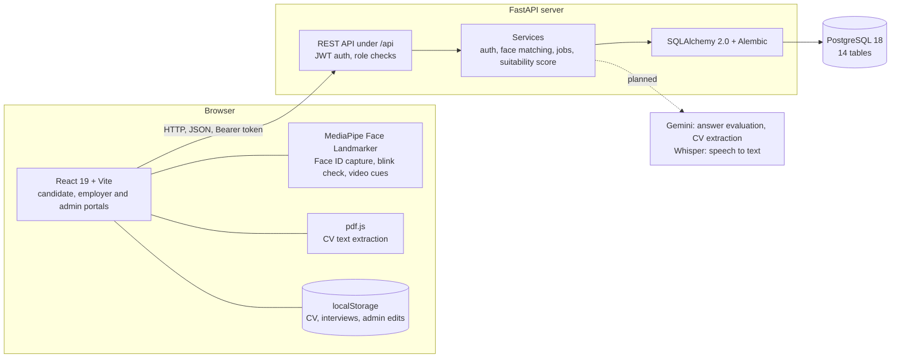

# Intervo Backend

REST API and PostgreSQL database for **Intervo**, an AI-assisted interview coaching and candidate screening platform.

Final Year Project, Department of Software Engineering, University of Gujrat.

Intervo helps a candidate prepare for interviews: it reads their CV, shows the skill gap against a target role or job description, runs mock interviews in text, voice or video, and tracks weak skills over time. Employers post jobs and see applicants ranked by an explainable suitability score, using only the evidence each candidate agreed to share. An admin configures the roles, skills, questions and scoring rules.

This repository is the server side. The React app is in **[Intervo-Frontend](https://github.com/shuneenraza-bot/Intervo-Frontend)**.

**Stack:** Python 3.13 · FastAPI · SQLAlchemy 2.0 · PostgreSQL 18 (psycopg 3) · Alembic · Pydantic · PyJWT · pwdlib (argon2) · pytest

## Contents

- [Features and objectives](#features-and-objectives)
- [Architecture](#architecture)
- [Setup on Windows](#setup-on-windows)
- [Demo accounts](#demo-accounts)
- [30% milestone](#30-milestone)
- [Known limitations](#known-limitations)
- [Endpoints](#endpoints)
- [Database](#database)
- [Project layout](#project-layout)

## Features and objectives

Status at the 30% evaluation. "Where it runs" matters because part of the system still runs in the browser (see [Known limitations](#known-limitations)).

| # | Objective | Feature | Where it runs | Status |
|---|---|---|---|---|
| 1 | Secure, role-based access | Sign up and sign in for candidates and employers, seeded admin, JWT, argon2 password hashes, attempt limits | Backend | ✅ Done |
| 2 | Convenient sign-in | Face ID as an alternative to the password, with a blink liveness check | Capture in browser (MediaPipe), matching on backend | ✅ Done (prototype matcher) |
| 3 | CV analysis and skill gap | Parse PDF/DOCX/TXT, extract skills, compare with a role template or a pasted job description | Browser (pdf.js) | ✅ Done in browser · ⏳ server-side with Gemini |
| 4 | Mock interviews | Text, voice and video modes; questions chosen from weaknesses, CV gaps and the role's key skills; follow-up questions | Browser | ✅ Done in browser · ⏳ server-side |
| 5 | Answer evaluation and feedback | Per-criterion scores against the admin rubric | Browser, rule-based | ✅ Rule-based · ⏳ Gemini evaluator |
| 6 | Speech to text | Spoken answers become a transcript | Browser (Web Speech API) | ✅ Browser · ⏳ Whisper |
| 7 | Presentation cues in video mode | Eye contact and expressiveness from face landmarks | Browser (MediaPipe) | ✅ Done |
| 8 | Progress tracking | Score history per skill and persistent weakness detection | Browser; session scores are also saved to PostgreSQL | ✅ Done |
| 9 | Employer module | Job postings with weighted skills, applications with consent, ranked candidates with an explainable suitability score | Backend | ✅ Done |
| 10 | Admin configuration | Domains, roles, skills, question templates, criteria and rules | Tables and seed data on backend, read through `GET /api/config`; editing screens save in the browser | ✅ Read from backend · ⏳ admin write endpoints |
| 11 | Persistent storage | 14-table PostgreSQL schema with migrations | Backend | ✅ Done |
| 12 | Deployment | Hosted demo | Not started | ⏳ Planned |

## Architecture



Solid lines exist today. The dotted line is planned work.

What goes to the server today: accounts and sign-in, Face ID templates, job postings, applications, the configuration the employer pages read, and a copy of each candidate's skills, CV summary and interview scores (needed for the ranking). CV text, contact details and answer text stay in the browser.

The database design is in **[docs/ERD.md](docs/ERD.md)**.

## Setup on Windows

You need:

- [Python 3.13](https://www.python.org/downloads/)
- [PostgreSQL 18](https://www.postgresql.org/download/windows/) (the installer includes pgAdmin). Remember the password you set for the `postgres` user.
- [Node.js](https://nodejs.org/) 20 or newer, for the frontend
- Git

### 1. Create the database

In pgAdmin: right-click **Databases** → **Create** → **Database…** → name it `intervo` → **Save**.

### 2. Backend

Run these in PowerShell from this folder.

```powershell
# Virtual environment and packages
py -3.13 -m venv .venv
.\.venv\Scripts\Activate.ps1
python -m pip install --upgrade pip
pip install -r requirements.txt

# .env from the example, with a random JWT secret
Copy-Item .env.example .env
$secret = python -c "import secrets; print(secrets.token_urlsafe(48))"
(Get-Content .env) -replace 'change-me-to-a-long-random-string', $secret | Set-Content .env -Encoding utf8
notepad .env    # replace YOUR_PASSWORD in DATABASE_URL, save, close

# Create the tables, then load the configuration and demo data
alembic upgrade head
python -m scripts.seed

# Run the server
uvicorn app.main:app --reload --port 8000
```

- If PowerShell refuses to run `Activate.ps1`, run `Set-ExecutionPolicy -Scope CurrentUser RemoteSigned` once.
- If your Postgres password contains `@ : / # % ?`, URL-encode those characters in `DATABASE_URL` (for example `@` becomes `%40`).
- `.env` is ignored by Git. Never commit it.

Check it: http://localhost:8000/api/health should return `{"status":"ok","database":"ok"}`. Interactive API docs (Swagger) are at http://localhost:8000/docs.

### 3. Frontend

In a second PowerShell window, in the [Intervo-Frontend](https://github.com/shuneenraza-bot/Intervo-Frontend) folder:

```powershell
npm install
Copy-Item .env.example .env
npm run dev          # http://localhost:5173
```

The frontend's `.env.example` already points at this server:

```
VITE_BACKEND_MODULES=auth,employer
VITE_API_URL=http://localhost:8000/api
```

### 4. Tests

```powershell
pytest -v
```

The 46 tests run against a separate database, `intervo_test`, which is created automatically. They never touch `intervo`.

### Maintenance scripts

| Command | What it does |
|---|---|
| `python -m scripts.seed` | Loads configuration and demo data. Safe to run again; existing rows are left alone. |
| `python -m scripts.cleanup_test_data --dry-run` | Lists users with an invalid email and job titles with stray quotes, without changing anything. |
| `python -m scripts.cleanup_test_data` | Fixes the job titles, then asks before deleting the listed users and their data. |
| `python -m scripts.generate_erd` | Regenerates `docs/ERD.md` from the models. |

## Demo accounts

Created by the seed script.

| Role | Email | Password |
|---|---|---|
| Candidate | ayesha@intervo.demo | Demo@1234 |
| Employer | hr@northstar.demo | Demo@1234 |
| Admin | admin@intervo.demo | Admin@1234 |

Two more demo candidates, `bilal@intervo.demo` and `sana@intervo.demo` (password `Demo@1234`), have applied to the employer's jobs so the ranking has data.

## 30% milestone

### Done

- **Authentication on the real backend.** Sign up, two-step sign in with a password **or** Face ID, JWT sessions, argon2 hashes, lockout after repeated failures.
- **Employer module on the real backend.** Create, edit, close and reopen job postings with weighted skills and success criteria. Candidates apply with consent. Employers see applicants ranked by an explainable suitability score and can shortlist or decline.
- **Candidate sync.** A candidate's skills, CV summary and interview scores are saved to PostgreSQL so the ranking uses real data.
- **CV analyzer** (frontend): PDF, DOCX or pasted text, skill extraction, weighted skill-gap against a role or job description.
- **Mock interviews** (frontend): text, voice and video, with follow-up questions and presentation cues.
- **Dashboards** (frontend): candidate overview and progress, employer hiring overview, admin configuration.
- **Database.** 14 tables with constraints and one Alembic migration, a seed script and an [ERD](docs/ERD.md).
- **Tests.** 46 automated API tests: sign up, sign in, Face ID, lockout, jobs, applications, ranking and privacy rules.

### Next steps

1. Move answer evaluation to the server with Gemini, with JSON validation of the model's output and the rule-based scorer as a fallback.
2. Move CV parsing to the server (`POST /api/cv/analyze`, `POST /api/jd/parse`) with Gemini-assisted extraction.
3. Send recorded audio to Whisper for transcription instead of relying on the browser.
4. Serve interviews from the server (`POST /api/interview/evaluate`, `GET /api/sessions`) so history follows the candidate across devices.
5. Add admin write endpoints so configuration changes are saved in PostgreSQL and apply to every user.
6. Add endpoints to delete an account and its history.
7. Replace the Face ID matcher with a face-embedding model and add password reset.
8. Deploy, then run user testing with students.

## Known limitations

These are stated plainly so the evaluation reflects what is really built.

- **Answer scoring is rule-based.** Answers are scored in the browser from keywords, length and structure. It is consistent and explainable, but it does not understand meaning. Gemini will replace it. Scores are a practice aid, not ground truth.
- **Face matching is a prototype.** The browser measures ratios between face landmarks and the server compares them with a mean-difference formula against a threshold. The blink check stops a printed photo, but this is not a trained face-recognition model and has not been measured for false accepts. It should not be the only protection for a real account; the password always remains available.
- **CV parsing and interviews still run in the browser.** The server has no `/cv`, `/jd` or `/interview` endpoints yet. Answer text and the full CV stay in the browser's `localStorage`, so that history does not move to another browser or device. Only skills, a CV summary and per-answer scores (with the video cues) reach the database.
- **No account deletion endpoint yet.** "Delete history" and "Delete account" in the app clear the browser copy only. The rows in PostgreSQL stay until a delete endpoint is added. The sharing switch is enforced on the server.
- **Admin edits are saved in the browser.** The admin screens change the configuration in `localStorage`. The employer pages read configuration from PostgreSQL, so an admin edit does not yet change the server-side ranking.
- **Speech to text depends on the browser.** Voice and video modes use the Web Speech API, which works in Chrome and Edge.
- **Rate limiting is per account, in the database.** There is no IP-based limiting, email verification or password reset yet.
- **Not deployed.** The system runs on localhost.

## Endpoints

All routes are under `/api`. Full request and response shapes are in the frontend's [API.md](https://github.com/shuneenraza-bot/Intervo-Frontend/blob/main/API.md) and at `/docs`.

| Method | Path | Who | Purpose |
|---|---|---|---|
| GET | `/api/health` | public | Server and database check |
| POST | `/api/auth/lookup` | public | Sign-in step 1: does the account exist, is Face ID enabled |
| POST | `/api/auth/signup` | public | Create a candidate or employer account |
| POST | `/api/auth/login` | public | Sign in with a password **or** a face template |
| GET | `/api/auth/me` | signed in | The current user |
| PUT | `/api/auth/face` | signed in | Enrol or replace Face ID. Body: `{ "template": { "v": 2, "method": "landmarks", "features": [...] } }` |
| DELETE | `/api/auth/face` | signed in | Remove Face ID |
| GET | `/api/config` | signed in | Domains, skills, roles, questions, criteria and rules |
| GET | `/api/jobs` | signed in | `{ jobs, applications }`. Open jobs; employers also get their own closed jobs, `applicantCount` and the applications on their jobs |
| POST | `/api/jobs` | employer | Create a job with weighted skills and success criteria |
| PUT | `/api/jobs/{id}` | job owner | Replace a job |
| PATCH | `/api/jobs/{id}/status` | job owner | `{ "status": "open" \| "closed" }` |
| POST | `/api/jobs/{id}/apply` | candidate | `{ "consent": true }`. Consent also turns on profile sharing |
| DELETE | `/api/jobs/{id}/apply` | candidate | Withdraw the application |
| PATCH | `/api/applications/{id}` | job owner | `{ "status": "new" \| "shortlisted" \| "declined" }` |
| GET | `/api/jobs/{id}/candidates` | job owner | Applicants ranked by suitability |
| PUT | `/api/profile` | candidate | Save `{ skills, cv: { education, experienceYears, projects } \| null, shareWithEmployers }` |
| POST | `/api/sessions` | candidate | Save a finished practice session's scores. Re-sending the same `id` returns the stored session with `200` |

### Candidate ranking and privacy

`GET /api/jobs/{id}/candidates` returns `{ job, hidden, candidates }`, best fit first. The score (see `app/services/suitability.py`) combines three parts, weighted by `suitability` in the `scoring_rules` row (40 / 45 / 15 after seeding):

- **CV skill match**: the job's weighted skills against the candidate's skills. A related skill earns half the weight.
- **Interview evidence**: the candidate's average scores on the job's skills, weighted the same way.
- **Practice consistency**: the number of sessions and the improvement trend.

Each result includes the three values, their weights and a one-line reason, so the employer can see why a candidate ranks where they do.

- Only applicants with `consent = true` on the application **and** `share_with_employers = true` on their profile are returned. Everyone else is only counted in `hidden`.
- Answer text, video indicators, face templates and CV contact details are never sent to employers.

### Sign-in rules

- Password and Face ID are alternatives. The login body holds `password` or `faceTemplate`, never both.
- Face ID compares the live template with the stored one: `similarity = max(0, 1 - mean(|a - b|) / 0.12)`. It is accepted when the similarity is at least `faceThreshold` in the `scoring_rules` row (0.55 after seeding).
- 5 wrong passwords in a row lock all sign-in for that account for 60 seconds (`429` with a `Retry-After` header).
- 3 failed Face ID attempts lock Face ID for that account until a password sign-in succeeds.
- Passwords are stored as argon2 hashes. Tokens are HS256 JWTs that expire after `JWT_EXPIRE_MINUTES`.

## Database

14 tables, all with `created_at` and `updated_at`. See **[docs/ERD.md](docs/ERD.md)** for the diagram and a description of each entity.

- **Accounts:** `users`, `candidate_profiles`
- **Admin configuration:** `domains`, `skills`, `job_roles`, `role_skills`, `question_templates`, `evaluation_criteria`, `scoring_rules`
- **Jobs:** `jobs`, `job_skills`, `applications`
- **Interviews:** `interview_sessions`, `session_answers`

IDs are strings (`cand-3f9a1c2b7d4e`, `frontend`, `q1`) because the frontend uses string IDs. The API sends timestamps as Unix epoch milliseconds.

### Changing the schema

Edit the models, then:

```powershell
alembic revision --autogenerate -m "describe the change"
alembic upgrade head
python -m scripts.generate_erd
```

Read the generated file in `alembic/versions/` before applying it.

## Project layout

```
app/
  main.py        FastAPI app, CORS, router registration
  config.py      Settings from .env
  db.py          Engine, session factory, Base, timestamp mixin
  deps.py        get_db, get_current_user, require_role
  models/        SQLAlchemy tables
  schemas/       Pydantic request and response models (camelCase JSON)
  routers/       HTTP endpoints
  services/      Business logic: auth, password and JWT, face comparison, jobs, suitability
alembic/         Migrations
docs/ERD.md      Entity relationship diagram, generated from the models
scripts/
  seed.py               Configuration and demo data, mirrors the frontend's src/data.js
  cleanup_test_data.py  Removes leftover test data
  generate_erd.py       Writes docs/ERD.md
tests/           pytest suite, runs against the intervo_test database
```
