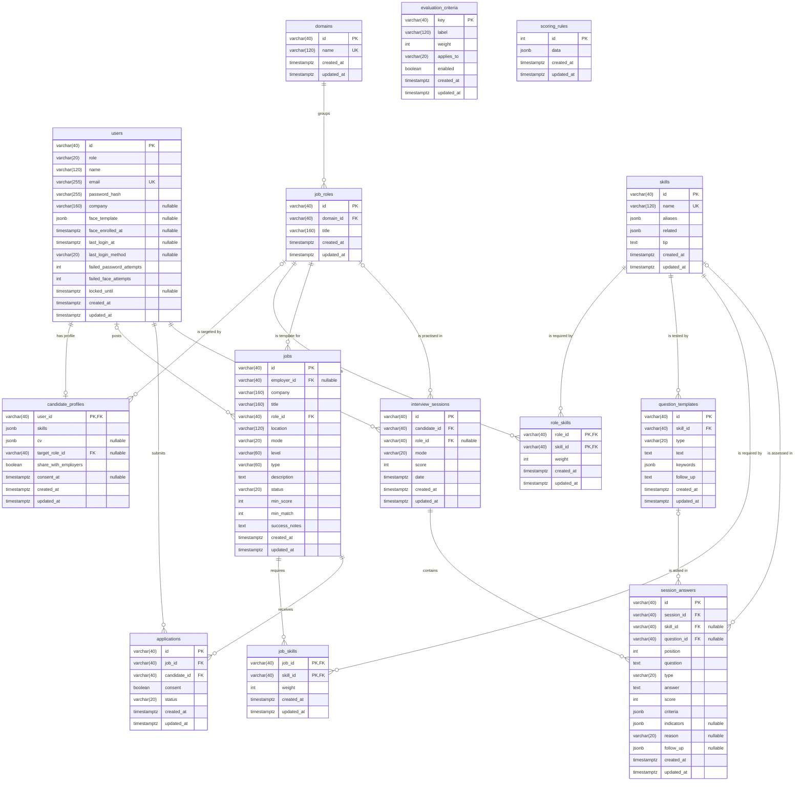

# Intervo database: entity relationship diagram

<!-- Generated by scripts/generate_erd.py from the SQLAlchemy models. Do not edit by hand. -->

The PostgreSQL schema has 14 tables. This file is generated from the SQLAlchemy models in `app/models/` with `python -m scripts.generate_erd`, so it always matches the code.

How to read it: `PK` primary key, `FK` foreign key, `UK` unique. Columns marked "nullable" may be empty; all others are required. `||--o{` is one to many, `|o--o{` is one to many where the parent is optional (the foreign key may be empty), and `||--o|` is one to zero or one.

## Entities

| Entity (table) | Group | Description |
|---|---|---|
| `users` | Accounts | An account: candidate, employer or admin. Holds the argon2 password hash, the optional Face ID landmark template and the sign-in attempt counters. |
| `candidate_profiles` | Accounts | One per candidate: confirmed skills, parsed CV summary, target role and the consent switch for sharing results with employers. |
| `domains` | Admin configuration | A career field (Technology, Business, Marketing, HR & Finance) that groups job roles. |
| `job_roles` | Admin configuration | A role template inside a domain, such as Frontend Developer, used for skill-gap analysis and interviews. |
| `skills` | Admin configuration | The skill library: name, aliases used to detect the skill in a CV, related skills for partial matches and an improvement tip. |
| `role_skills` | Admin configuration | Which skills a role template needs and how important each one is (weight 1 to 3). |
| `question_templates` | Admin configuration | An interview question for one skill, technical or behavioral, with expected keywords and a follow-up question. |
| `evaluation_criteria` | Admin configuration | A rubric criterion for scoring answers (relevance, clarity, STAR structure and so on) with its weight. |
| `scoring_rules` | Admin configuration | A single row of admin-set rules: weakness threshold, follow-up trigger, Face ID match threshold and suitability weights. |
| `jobs` | Jobs | A job posting by an employer, with success criteria (minimum interview score and minimum CV match). |
| `job_skills` | Jobs | The skills a job posting requires and their weights (1 to 3), used for the CV match and suitability score. |
| `applications` | Jobs | A candidate's application to a job, with their consent to share evidence and the employer's decision. |
| `interview_sessions` | Interviews | One finished mock interview: candidate, role, mode (text, voice or video), overall score and date. |
| `session_answers` | Interviews | One question inside a session: the skill tested, score, per-criterion scores, video cues and follow-up. |

## Relationships

| Parent | Child | Foreign key | Cardinality | On delete |
|---|---|---|---|---|
| `users` | `candidate_profiles` | `user_id` | one to zero or one | CASCADE |
| `job_roles` | `candidate_profiles` | `target_role_id` | one to many, parent optional | SET NULL |
| `domains` | `job_roles` | `domain_id` | one to many, parent required | RESTRICT |
| `job_roles` | `role_skills` | `role_id` | one to many, parent required | CASCADE |
| `skills` | `role_skills` | `skill_id` | one to many, parent required | CASCADE |
| `skills` | `question_templates` | `skill_id` | one to many, parent required | CASCADE |
| `users` | `jobs` | `employer_id` | one to many, parent optional | SET NULL |
| `job_roles` | `jobs` | `role_id` | one to many, parent required | RESTRICT |
| `jobs` | `job_skills` | `job_id` | one to many, parent required | CASCADE |
| `skills` | `job_skills` | `skill_id` | one to many, parent required | CASCADE |
| `jobs` | `applications` | `job_id` | one to many, parent required | CASCADE |
| `users` | `applications` | `candidate_id` | one to many, parent required | CASCADE |
| `users` | `interview_sessions` | `candidate_id` | one to many, parent required | CASCADE |
| `job_roles` | `interview_sessions` | `role_id` | one to many, parent optional | SET NULL |
| `interview_sessions` | `session_answers` | `session_id` | one to many, parent required | CASCADE |
| `skills` | `session_answers` | `skill_id` | one to many, parent optional | SET NULL |
| `question_templates` | `session_answers` | `question_id` | one to many, parent optional | SET NULL |

## Notes for the design chapter

- `role_skills` and `job_skills` are associative entities. They resolve the many-to-many relationships between roles and skills, and between jobs and skills, and carry the weight of each skill.
- `applications` resolves the many-to-many relationship between candidates and jobs. A candidate can apply to a job only once (unique on `job_id` + `candidate_id`).
- `users` holds all three roles in one table, separated by the `role` column. Only candidates have a `candidate_profiles` row.
- `jobs.employer_id` may be empty for listings that are not owned by an Intervo employer account.
- `scoring_rules` has exactly one row (`id = 1`), enforced by a check constraint.
- JSON columns (`jsonb`) hold lists and nested objects that are always read as a whole: skill aliases, the parsed CV, per-criterion scores and the Face ID landmark template.
- Every table has `created_at` and `updated_at`. IDs are short strings such as `cand-3f9a1c2b7d4e`.
